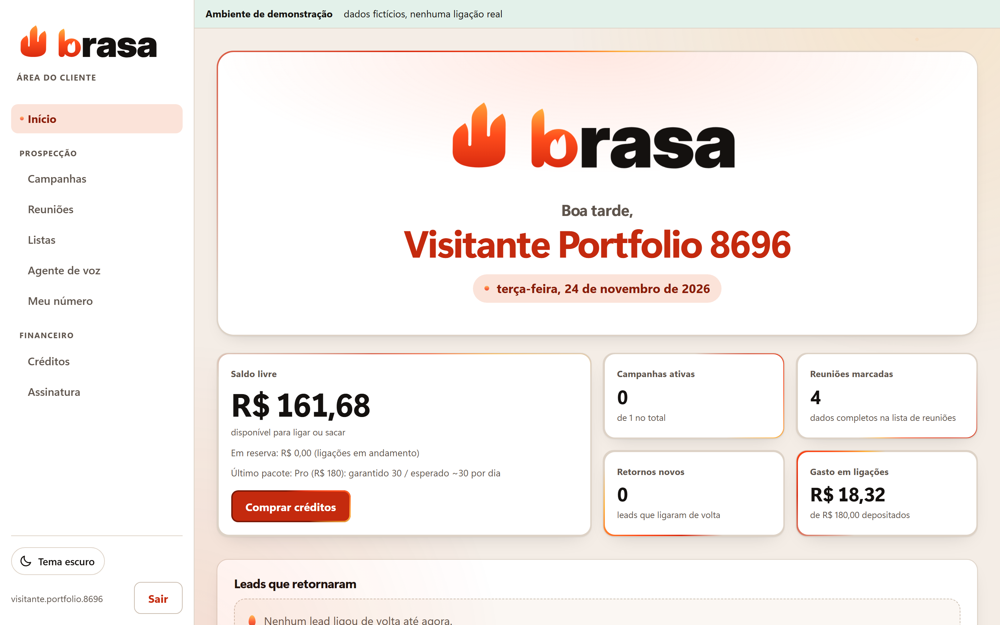
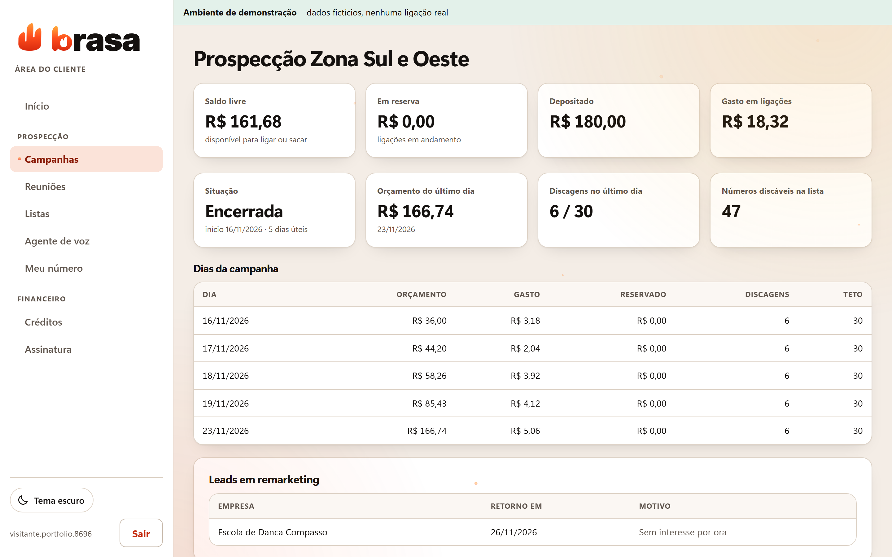
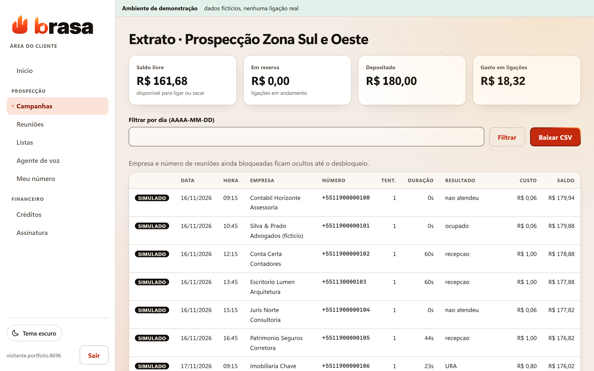
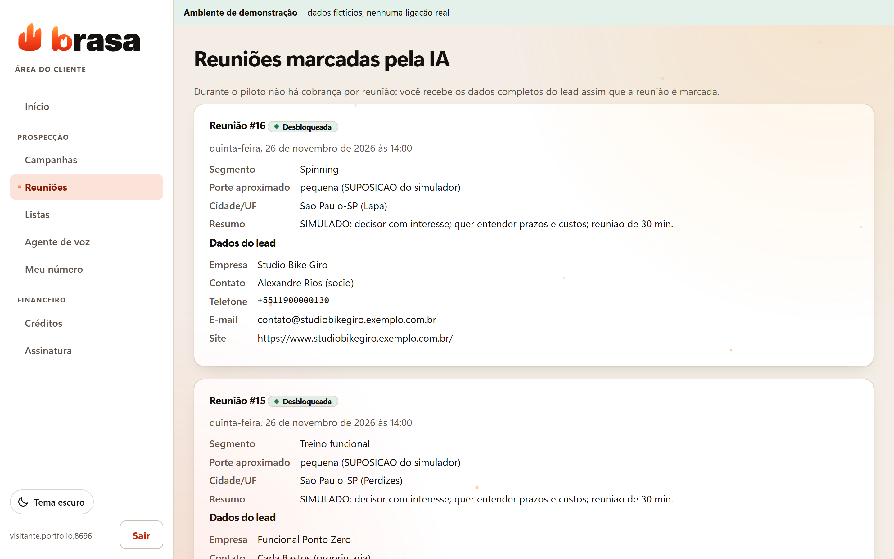
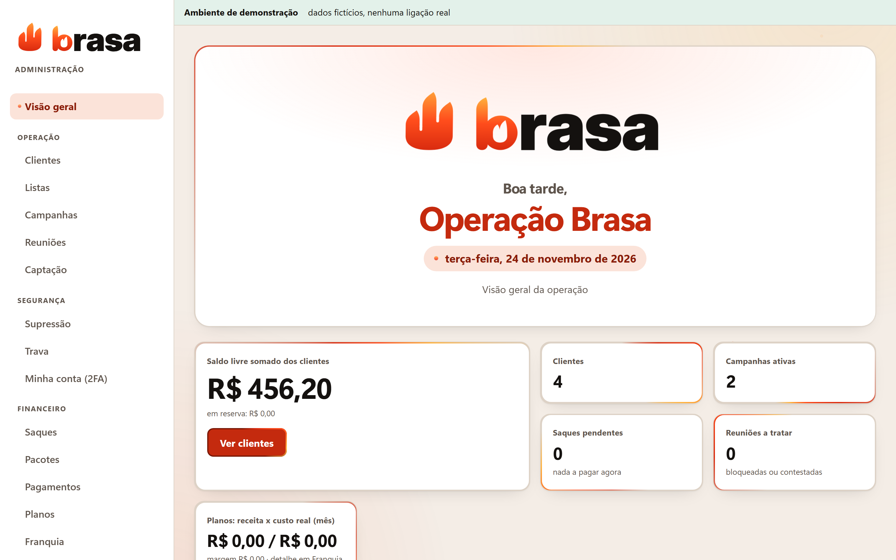

<h3 align="center">SDR de voz com IA: liga, qualifica e agenda reuniões</h3>

  <a href="https://brasa-demo-five.vercel.app"><b>Acessar a demo</b></a> ·
  <a href="https://fbarbosa8.github.io/brasa-sdr-voz-ia/"><b>Página do projeto</b></a>

---

A **Brasa** é um SaaS de prospecção B2B. Ela liga para listas de empresas com um agente de voz por IA, conversa com quem atende e marca reuniões para o time comercial do cliente. O cliente acompanha tudo em um portal, com créditos pré-pagos e extrato por ligação.

> **Sobre este repositório:** é a vitrine do projeto. O código-fonte é privado. Aqui ficam a descrição, as telas e o link da demo.

## Teste a demo

1. Abra **[a demo](https://brasa-demo-five.vercel.app)** e crie uma conta só com nome e senha.
2. A conta já vem com uma semana de operação simulada: lista de empresas, campanha, ligações, reuniões e extrato.
3. Tudo é fictício e a telefonia é simulada. Nenhuma ligação real é feita.

## O que foi construído

| | |
|---|---|
| **Portal do cliente** | Campanhas, listas, reuniões, configuração do agente de voz, créditos e saque |
| **Painel administrativo** | Visão da operação, clientes, pagamentos, lista de supressão e trava central de ligações |
| **Créditos auditáveis** | Reserva antes de discar e débito por ligação em livro-caixa imutável |
| **Segurança** | Isolamento de dados por cliente no banco, 2FA no admin, CSRF, CSP restritiva, hash de senha forte |
| **Simulador de telefonia** | Reproduz o provedor de voz real com eventos assinados, para testar sem custo |
| **Qualidade** | Testes de unidade, integração e ponta a ponta, mais verificação de acessibilidade |

## Telas

| Campanha | Extrato por ligação |
|---|---|
|  |  |
| **Reuniões** | **Admin** |
|  |  |

## Tecnologia

TypeScript · Node.js · Hono (JSX no servidor) · htmx · PostgreSQL · Drizzle ORM · Neon · Vercel · Vitest · Playwright · Zod

---

Projeto de **Felipe Barbosa**, 2026. Código-fonte privado. © Todos os direitos reservados. As imagens e a marca deste repositório não podem ser reutilizadas sem autorização.
